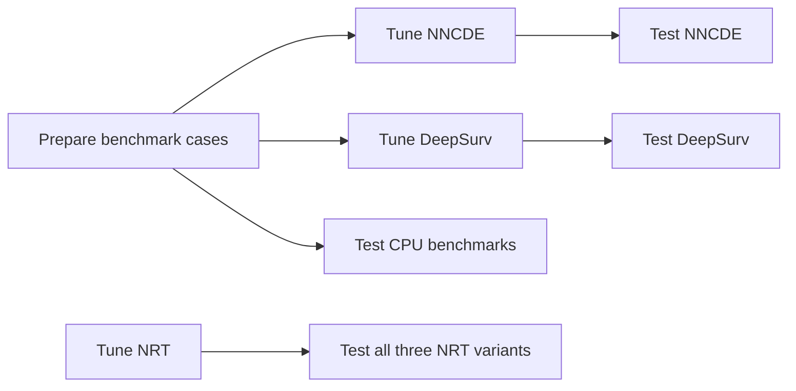

# NRT: Neural Tree Models for Survival Analysis

NRT is a research implementation of neural tree models for conditional survival
estimation with exact, right-censored, current-status, and interval-censored
observations. This repository provides a reproducible simulation workflow for
comparing fixed and adaptive time partitions with established survival models.

The reference experiment is
[`nrt-29cases-20261113_223129`](nrt-29cases-20261113_223129/README.md):
**29 simulation cases, 500 replications per supported method/case, and 5,000
observations per dataset**. Its frozen source, environment inventories, tuning
records, and result tables define the reproduction target.

[Experiment guide](nrt-29cases-20261113_223129/README.md) ·
[Environment setup](nrt-29cases-20261113_223129/ENVIRONMENT_REPLICATION.md) ·
[Benchmark tables](nrt-29cases-20261113_223129/benchmarks/testing/tables/) ·
[NRT tables](nrt-29cases-20261113_223129/partition_kl/testing/tables/)

## Model and comparisons

The retained NRT model partitions the observed time range with a neural tree and
represents probability beyond the training horizon as a separate tail mass.
The horizon is the largest finite observed training endpoint. In this
implementation, a final split of the rightmost body leaf separates its body mass
from the tail. Training uses the observation likelihood, with a partition-KL
penalty for the adaptive model.

| NRT variant | Partition and model selection |
| --- | --- |
| `fixed_nll_cv` | Fixed partition; architecture selected by cross-validated negative log-likelihood |
| `adaptive_nll_cv` | Learned partition; architecture and regularization selected by cross-validated negative log-likelihood |
| `fixed_at_adaptive_architecture` | Fixed-partition control using the adaptive model's selected architecture, with regularization strength set to zero |

The benchmark implementations support the following observations:

| Method | Exact | Right-censored | Current-status | Interval-censored | Cases |
| --- | :---: | :---: | :---: | :---: | ---: |
| NNCDE | ✓ | ✓ | — | — | 15 |
| DeepSurv | ✓ | ✓ | — | — | 15 |
| Deep distribution regression | ✓ | — | — | — | 5 |
| Conditional inference tree (`ctree`) | ✓ | ✓ | ✓ | ✓ | 29 |
| ICcforest | — | ✓ | ✓ | ✓ | 24 |
| Cox (`cox`) | ✓ | ✓ | ✓ | ✓ | 29 |
| Accelerated failure time (`aft`) | ✓ | ✓ | ✓ | ✓ | 29 |

All three NRT variants cover all 29 cases. Together, the benchmark and NRT
testing stages produce **116,500 replication records**.

## Experiment design

The five data-generating settings are proportional hazards (`ph`), lognormal,
proportional odds (`po`), and two multimodal settings
(`multimodal_separate` and `multimodal_closer`).

| Observation scheme | Retained cases |
| --- | ---: |
| Exact | 5 |
| Right-censored | 10 |
| Current-status | 6 |
| Interval-censored | 8 |
| **Total** | **29** |

Censored cases use `q = 0.2` or `0.5`. Both multimodal settings exclude
current-status cases at both q values and the interval-censored case at q=0.5.
Exact-case identifiers retain the suffix `q0.2` for consistency; their outcomes
are fully observed.

The protocol uses an 80/20 train/test split, four-fold cross-validation, base
seed 123, and a 256-point evaluation grid. Methods share the generated dataset
and split within each case and replication. Case indices remain fixed after
exclusions, so their seed assignments do not shift.

| Tuning procedure | Search budget | Training epoch limit |
| --- | --- | ---: |
| Fixed and adaptive NRT | 200 trials per searched method/case; 20 initial trials | 200 |
| NNCDE | 27 grid candidates per case | 200 |
| DeepSurv | 50 candidate evaluations per case | 1,000 |

The matched NRT control reuses the adaptive architecture without an additional
architecture search. NRT testing uses the saved refit epoch counts. Detailed
settings are recorded in the reference experiment's `submission.json` and
`preflight_configuration.json`.

## Repository layout

```text
NRT/
├── README.md
├── nrt-29cases-20261113_223129/
│   ├── README.md                    # Reproduction workflow
│   ├── ENVIRONMENT_REPLICATION.md   # Exact environment setup
│   ├── SOURCE_SHA256SUMS            # Frozen source checksums
│   ├── source/                     # Models, generators, tuning, and evaluation
│   │   ├── regularization/         # NRT implementation
│   │   ├── tuning/                 # Shared generators and benchmark tuning
│   │   ├── testing/                # Benchmark testing
│   │   └── environment/            # Pinned Python/R inventory
│   ├── launchers/                  # Reference Slurm launchers
│   ├── environment/                # Environment capture and verification tools
│   ├── benchmarks/                 # Benchmark tuning and testing outputs
│   └── partition_kl/               # NRT tuning and testing outputs
└── realworld/                      # Separate real-world experiments
```

The simulation workflow uses the reference directory's `source/` tree.
The instructions below concern that simulation; real-world experiments are
separate.

## Set up the reference environment

The recorded runtime uses **Python 3.14.2, R 4.4.0, and
PyTorch 2.11.0+computecanada**. Full package/build versions, CUDA/cuDNN, native
libraries, and module settings are recorded in
[`source/environment/fir-20261021/`](nrt-29cases-20261113_223129/source/environment/fir-20261021/).
Follow the [environment guide](nrt-29cases-20261113_223129/ENVIRONMENT_REPLICATION.md)
to restore the pinned environment on another machine. The inventory does not
include a wheelhouse or container image.

With that environment available, start a fresh Bash shell **at the repository
root**:

```bash
set -euo pipefail
export NRT_REFERENCE="$PWD/nrt-29cases-20261113_223129"
export NRT_ROOT="$NRT_REFERENCE/source"
export PYTHONDONTWRITEBYTECODE=1

# Set NRT_VENV or PY first if the pinned environment uses another location.
source "$NRT_ROOT/runtime.sh"
export PY

# runtime.sh changes the working directory to source/.
sha256sum --quiet -c "$NRT_REFERENCE/SOURCE_SHA256SUMS"
"$PY" "$NRT_REFERENCE/validate_environment.py"
"$PY" -m unittest test_preflight test_node_runner
```

The environment validator checks the recorded runtime and Python/R backends and
refreshes its validation reports. The original validation accepts additional R
packages only when they are not loaded by the benchmark backends.

Preview the requested simulation dimensions without fitting models:

```bash
"$PY" -m testing.simulation run --methods NNCDE --dry-run
"$PY" -m regularization.testing.simulation run --dry-run
```

These previews report 15 NNCDE cases and 29 cases × 3 NRT methods, each with 500
replications. They do not establish GPU availability; allocated jobs perform
CPU/GPU and backend checks before fitting.

## Reproduce the reference experiment

Choose the level of reproduction needed:

| Goal | Procedure |
| --- | --- |
| Inspect the saved results | Open the benchmark, NRT, and tail-bias CSV tables linked below |
| Rebuild tables from saved replications | Run the summary commands below |
| Refit with the selected reference parameters | Follow [Refit using saved parameters](nrt-29cases-20261113_223129/README.md#refit-using-saved-parameters) |
| Repeat preparation, tuning, and all testing | Follow [Full reproduction](nrt-29cases-20261113_223129/README.md#full-reproduction) |

A full reproduction has the following dependencies:



The [experiment guide](nrt-29cases-20261113_223129/README.md) provides the complete
Slurm commands, including fresh output directories, job dependencies, and
relocation of launcher paths. The reference launchers target Fir H100 MIG
resources and contain absolute paths. The guide creates adapted copies for the
new run while preserving the frozen numerical source.

## Results and metrics

| Output | Contents |
| --- | --- |
| [Benchmark tables](nrt-29cases-20261113_223129/benchmarks/testing/tables/) | 29 CSVs; one column per supported benchmark method |
| [NRT tables](nrt-29cases-20261113_223129/partition_kl/testing/tables/) | 29 CSVs comparing the three NRT variants |
| [NRT tail-bias tables](nrt-29cases-20261113_223129/partition_kl/testing/tables_tau_absolute_bias/) | 29 CSVs for survival error at the training horizon |

Each table contains replications 1–500, followed by `average` and
`standard_deviation` rows. Lower values indicate smaller errors.

The main metric, `average_grid_sse`, sums squared differences between estimated
and true survival probabilities over the evaluation grid, then averages over
test subjects. It is **not divided by the number of grid points**. NRT's
`survival_tau_absolute_bias` averages the absolute survival-probability error
over test subjects at the largest finite observed training endpoint. That
endpoint is distinct from the censoring generator's saved `tau`.

To rebuild the saved reference tables, use the environment setup above and run:

```bash
cd "$NRT_ROOT"
"$PY" -m testing.simulation summarize \
  --output-dir "$NRT_REFERENCE/benchmarks/testing" --replications 500
"$PY" -m regularization.testing.simulation summarize \
  --output-dir "$NRT_REFERENCE/partition_kl/testing" --replications 500
```

These commands read existing replication JSON files and regenerate the summary
CSVs without refitting. NRT summarization produces both SSE and tail-bias tables.
Incomplete or failed replications are reported rather than treated as complete.

Raw replication JSON files and logs are ignored by the current Git rules.
Rebuilding tables requires those raw results in addition to the CSVs. A fresh
simulation instead requires the complete frozen source and environment
inventories; all datasets are generated from the specified case settings and
seeds.

## Reproducibility

The experiment's `SOURCE_SHA256SUMS` identifies the 86 frozen source and
environment files. Keep those bytes, selected parameters, seeds, search budgets,
and training settings fixed when comparing with the reference. Use a fresh
output directory for independent runs; existing results are reused only when
the workflow's compatibility checks pass.

The original run configuration and environment reports accompany the results.
Environment and source checks establish the recorded configuration, while
agreement across hardware must be assessed from numerical outputs. Differences
in GPU type, native libraries, floating-point behavior, or package builds can
change fitted models and scores.
